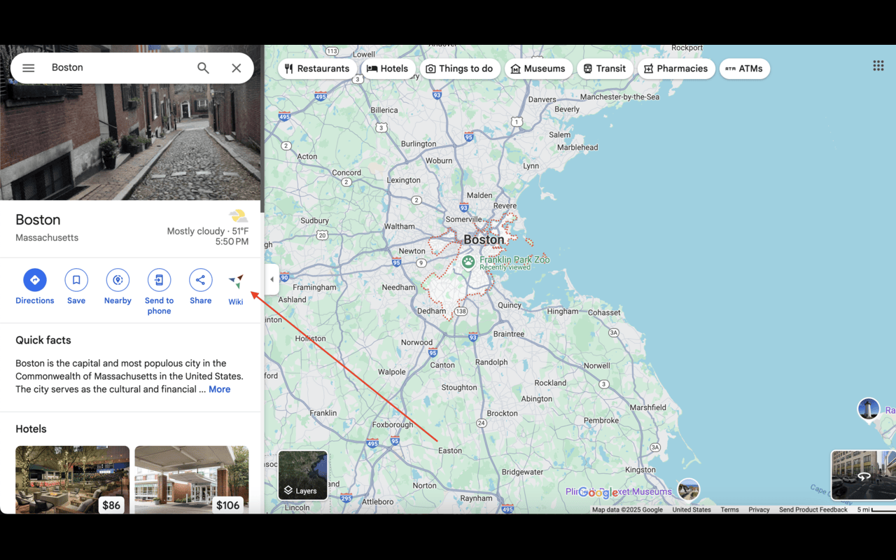

# GMapWikiVoyage

GMapWikiVoyage is a Chrome extension that adds a Wikivoyage shortcut to Google Maps place pages. When you open a destination in Google Maps, the extension looks for the matching Wikivoyage article and adds a small `Wiki` button beside the standard Maps actions.



## Where to install
This extension has been published [here](https://chromewebstore.google.com/detail/madpmemifpklkgfachncnopjhlpipmek?utm_source=item-share-cb) on the Chrome Webstore. Simply install it to your browser and open up Google Maps. It will automatically detect the place you're looking at and display a link to the relevent WikiVoyage page if one exists.

## What It Does

- Detects the current place page in Google Maps.
- Searches Wikidata for the matching Wikivoyage destination.
- Checks coordinates to avoid opening an unrelated article with a similar name.
- Adds a lightweight Wikivoyage button to the Google Maps action row.
- Opens the matching Wikivoyage travel guide in a new tab.

## Contributing

Contributions are welcome! Please read our [Contributing Guidelines](CONTRIBUTING.md) before opening an issue or pull request.

## Why I Built It

Google Maps is great for navigation and local discovery, while Wikivoyage is great for travel context: neighborhoods, practical tips, itineraries, culture, and destination overviews. This extension connects those workflows so trip research can move from map to travel guide in one click.

## Tech Stack

- Chrome Extension Manifest V3
- JavaScript
- Webpack
- Wikidata API
- Wikivoyage pages

## Local Setup

Install dependencies:

```bash
npm install
```

Build the extension:

```bash
npm run build
```

For development with automatic rebuilds:

```bash
npm run watch
```

## Test Locally in Chrome or Edge

1. Build the project with `npm run build`.
2. Open `chrome://extensions` or `edge://extensions`.
3. Enable Developer mode.
4. Click "Load unpacked".
5. Select the `dist` folder from this repo.
6. Open Google Maps and search for a destination, such as Boston.

The extension should add a `Wiki` button to supported Google Maps place pages when it finds a matching Wikivoyage article.

## Package for Distribution

Build first:

```bash
npm run build
```

Then zip the contents of `dist`. The repository includes a generated `dist.zip` for local testing, but for publishing it is best to rebuild and package from a clean checkout.

## Privacy

GMapWikiVoyage does not include analytics, ads, tracking, or monetization SDKs. It only uses page context from Google Maps to search public Wikidata and Wikivoyage resources for the requested destination.

## Notes

This project is not affiliated with Google Maps, Wikivoyage, Wikidata, Wikimedia, or Google. It is an independent browser extension built as a portfolio project.
